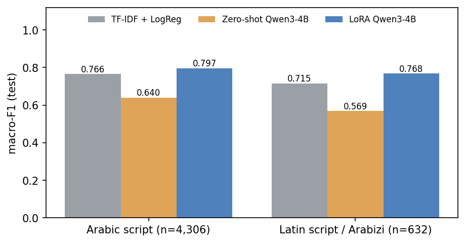
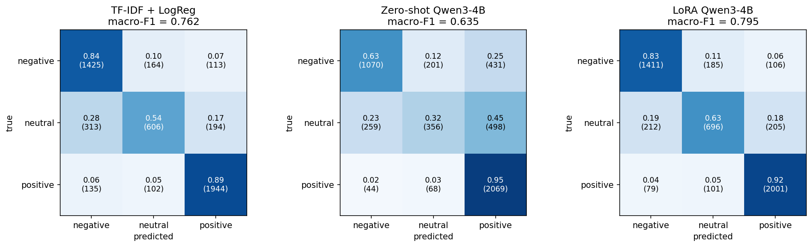
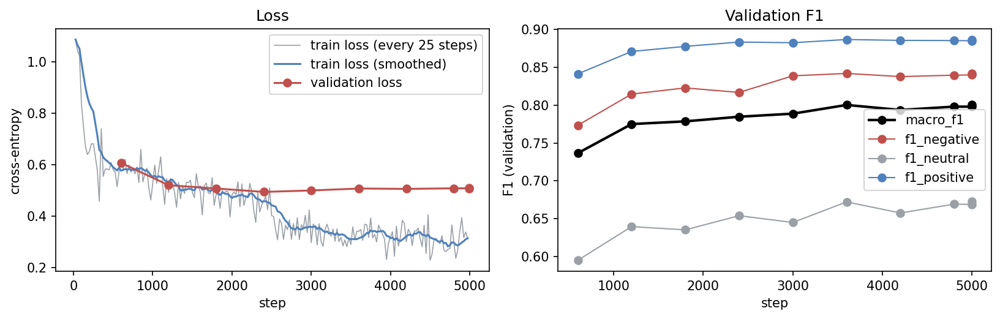

# Darija sentiment with a LoRA-tuned LLM

Fine-tuning an open-weight language model (Qwen3-4B) with LoRA to classify the sentiment of Algerian Darija comments, in both Arabic script and Latin script ("Arabizi"). It's compared against a classic TF-IDF model and against zero-shot prompting of the same LLM.

**Adapter on the Hugging Face Hub:** [Sadjed123/qwen3-4b-darija-sentiment-lora](https://huggingface.co/Sadjed123/qwen3-4b-darija-sentiment-lora)

---

## Why this project

Algerians don't write online in Modern Standard Arabic. They write in Darija, a dialect mixed with French, Berber and some English, and they write it in two scripts. One comment says `ربي يحفظك` and the next says `rabi y7afdek`, which means the same thing ("God protect you"). In Arabizi, numbers stand in for sounds Latin letters can't spell: `3` is ع, `7` is ح, `9` is ق.

Most Arabic NLP tools are built for MSA and do poorly on this. I wanted to answer a practical question: **can you take a general open LLM and, on a single consumer GPU, turn it into a sentiment classifier that handles real Algerian comments in both scripts? Is that actually better than the cheap classic approach?**

## Results

All numbers are on the same held-out test set of 4,996 YouTube comments (4,306 in Arabic script, 632 in Latin script). The main metric is **macro-F1**, because the classes are unbalanced and "neutral" is the minority class. Brackets show 95% bootstrap confidence intervals.

| System                       | Macro-F1                | Accuracy  | F1 neutral | Macro-F1, Arabic script | Macro-F1, Latin script |
| ---------------------------- | ----------------------- | --------- | ---------- | ----------------------- | ---------------------- |
| TF-IDF + logistic regression | 0.762 (0.749–0.774)     | 0.796     | 0.611      | 0.766                   | 0.715                  |
| Zero-shot Qwen3-4B-Instruct  | 0.635 (0.620–0.649)     | 0.700     | 0.410      | 0.640                   | 0.569                  |
| **LoRA fine-tuned Qwen3-4B** | **0.795 (0.783–0.806)** | **0.822** | **0.664**  | **0.797**               | **0.768**              |

<p align="center">
  
</p>

In short:

- **LoRA beats TF-IDF by 3.3 points** (paired bootstrap 95% CI: +2.0 to +4.4). That's a real gap, but a smaller one than I expected, because the TF-IDF baseline is strong.
- **LoRA beats zero-shot prompting of the same model by 16 points.** Most of what makes the LLM good here comes from fine-tuning, not from the prompt.
- **The biggest gains are on Arabizi** (+5.3 over TF-IDF) and on very short comments (+4.5 on 1–3 word comments), which are exactly the cases where n-gram features have the least to work with.
- **Neutral is the hard class for every system**, and the error analysis suggests a lot of that comes from inconsistent labels rather than model mistakes (more on that below).

<p align="center">
  
</p>

## How it works

**Data.** I use the [Algerian dialect sentiment dataset](https://huggingface.co/datasets/Abdou/dz-sentiment-yt-comments) by Benmounah et al. (2023): 50,016 YouTube comments labelled by hand as negative, neutral or positive. I removed near-duplicates (including 7 strings that appeared with _different_ labels) and tagged each comment's script with a simple letter-counting rule. About 13% of the data is Latin script. The 80/10/10 split is stratified on label _and_ script, so every split has the same mix of both.

**Baseline 1: TF-IDF + logistic regression.** Character n-grams (2–5) plus word uni- and bi-grams on lightly normalised text (folded alef variants, squeezed letter repeats such as `هههههه` → `هه`, and so on). Character n-grams matter a lot for a language without standard spelling: `bezaf`, `bzaf` and `bezzaf` share most of their pieces. Regularisation is tuned on the validation set. It trains in 15 seconds on a CPU.

**Baseline 2: zero-shot prompting.** Qwen3-4B-Instruct-2507 is given the comment and a description of the three labels. Instead of generating text and parsing it, I read the model's next-token probabilities for the words `negative`, `neutral` and `positive`. That always gives a valid answer and a proper probability for each class. I tried two prompts and picked the better one **on the validation set**. The second prompt encodes how this dataset's annotators treat blessings and condolences (mostly positive), which I measured on the training split.

**The LoRA model.** The same Qwen3-4B with its language-model head replaced by a 3-way classification head, plus LoRA adapters (r = 16, α = 32) on every attention and MLP projection. Only 33M of the 4.06B parameters are trained (0.8%). The frozen base stays in bf16, the adapters train in fp32, and gradient checkpointing keeps the whole thing within **10.6 GB of GPU memory**, so it runs on an RTX 5070 (12 GB) next to a normal desktop. Two epochs took **66 minutes**. The best checkpoint was chosen by validation macro-F1 (0.800).

<p align="center">
  
</p>

The curves show the model learning most of what it can in the first epoch. In the second epoch training loss keeps falling, but validation F1 only edges up from 0.785 to 0.800 and validation loss doesn't improve at all. That's why I selected checkpoints on F1 rather than on loss.

## What the errors say

The part of this project I found most interesting was reading the mistakes. In short:

**Many of the model's most confident "mistakes" are actually label errors.** Of the 25 test comments the model was most confident about and still "got wrong", roughly 17 look mislabelled to me. A few examples, all labelled **neutral** in the dataset:

- `انا نحبكم بزاف جربنا معمول الورقة روعة روعة` (_I love you so much, we tried the recipe, amazing amazing_). The model says positive.
- `يسقط جنرالات الجزائر العملاء…` (_down with the traitor generals…_). The model says negative.
- `Khlas wahad mawala ihabak… nti machi moslima` (_nobody loves you anymore… you're not a Muslim_). The model says negative.

**The labels are inconsistent for whole types of comment.** Checking recurring comment types across the full dataset:

| Comment contains                           | negative | neutral | positive |
| ------------------------------------------ | -------- | ------- | -------- |
| laughter (`ههه`, `hhh`, 😂)                | 37%      | 29%     | 34%      |
| crying emoji (😭 😢)                       | 30%      | 21%     | 48%      |
| condolences (`الله يرحمه`, `rabi yarhmou`) | 20%      | 14%     | 66%      |
| a question mark                            | 34%      | 60%     | 6%       |

Laughter can be fun or mockery, and tears can be grief or being moved, so annotators split. For these comments the gold label depends as much on who annotated it as on the text, which caps how high _any_ model can score on this test set.

**The model's real blind spot is complaints dressed up as questions.** "Where are the PCR tests? There are none in Batna." "Where's the beauty? I don't see it." Questions are neutral 60% of the time in the training data, so the model learns that a question mark means neutral and misses the complaint. The other recurring failure is the mirror image: comments that open with praise and then criticise (`بحب اتفرج عليك قوي… بس…`, _I really love watching you… but the music drowns out your voice_) get read as positive.

**Its confidence is meaningful.** On the two-thirds of comments where the model is at least 90% sure, accuracy is 93%. In a real moderation or analytics pipeline you could act on those automatically and send the rest to a person.

All of this is in [`notebooks/05_evaluation_and_error_analysis.ipynb`](notebooks/05_evaluation_and_error_analysis.ipynb), with the tables and many more examples.

## What's in the repo

```
darija-sentiment-lora/
├── notebooks/
│   ├── 01_data_exploration.ipynb          # dataset, scripts, duplicates, lengths, the split
│   ├── 02_tfidf_baseline.ipynb            # baseline 1 + which n-grams it relies on
│   ├── 03_zero_shot_baseline.ipynb        # baseline 2 + prompt selection on validation
│   ├── 04_lora_finetuning.ipynb           # LoRA setup explained + training curves
│   └── 05_evaluation_and_error_analysis.ipynb
├── scripts/
│   ├── train_lora.py                      # the actual training run
│   └── push_to_hub.py                     # uploads adapter + model card
├── src/darija_sentiment/                  # shared code used by notebooks and scripts
│   ├── config.py                          # paths, labels, base model
│   ├── data.py                            # loading, cleaning, script detection, splits
│   ├── llm.py                             # zero-shot classifier, LoRA model, inference
│   ├── metrics.py                         # macro-F1, bootstrap CIs, confusion matrices
│   └── model_card.py                      # renders the Hub model card from results
├── results/
│   ├── metrics/                           # one JSON per system
│   ├── predictions/                       # test-set predictions for every system
│   ├── figures/
│   └── summary.json
└── model_card/README.md                   # the model card published on the Hub
```

The data (`data/`) and the trained weights (`outputs/`) are not committed. The data downloads automatically, and the adapter lives on the Hub.

## Running it yourself

You'll need Python 3.10+ and, for the LLM parts, an NVIDIA GPU with at least 12 GB of memory. The TF-IDF notebook runs on any laptop.

```bash
git clone https://github.com/sadjedb/darija-sentiment-lora.git
cd darija-sentiment-lora

# PyTorch with CUDA first (pick the right command for your setup at pytorch.org)
pip install torch --index-url https://download.pytorch.org/whl/cu128
pip install -r requirements.txt
```

Then, in order:

1. **`notebooks/01_data_exploration.ipynb`** downloads the data and writes the splits to `data/splits/`.
2. **`notebooks/02_tfidf_baseline.ipynb`**: about a minute on a CPU.
3. **`notebooks/03_zero_shot_baseline.ipynb`**: about 15 minutes on the GPU (two prompts on validation, one on test).
4. **Train the adapter:**
   ```bash
   python scripts/train_lora.py --smoke-test   # 1-minute check that everything works
   python scripts/train_lora.py                # the real run, ~65 min on an RTX 5070
   ```
5. **`notebooks/04_lora_finetuning.ipynb`** plots the training run.
6. **`notebooks/05_evaluation_and_error_analysis.ipynb`** runs the test evaluation, the comparison and the error analysis, and writes the model card.

If you're short on GPU memory, `--batch-size 8 --grad-accum 2` gives the same effective batch size with less memory.

### Publishing the adapter

```bash
hf auth login                                   # token with write access
python scripts/push_to_hub.py --repo-id Sadjed123/qwen3-4b-darija-sentiment-lora
```

This uploads only the adapter (132 MB), the model card and the confusion-matrix figure. The 8 GB base model stays on Qwen's repo.

## Using the trained model

```python
import torch
from peft import PeftModel
from transformers import AutoModelForSequenceClassification, AutoTokenizer

base_id = "Qwen/Qwen3-4B-Instruct-2507"
adapter_id = "Sadjed123/qwen3-4b-darija-sentiment-lora"

tokenizer = AutoTokenizer.from_pretrained(base_id)
model = AutoModelForSequenceClassification.from_pretrained(
    base_id, num_labels=3, dtype=torch.bfloat16, device_map="auto",
    id2label={0: "negative", 1: "neutral", 2: "positive"},
)
model.config.pad_token_id = tokenizer.pad_token_id
model = PeftModel.from_pretrained(model, adapter_id).eval()

texts = ["ya3tik saha khoya, khedma mli7a", "خسارة الوقت لي ضيعتو في هاد الفيديو"]
batch = tokenizer(texts, return_tensors="pt", padding=True).to(model.device)
with torch.no_grad():
    probs = model(**batch).logits.float().softmax(-1)
print([model.config.id2label[i] for i in probs.argmax(-1).tolist()])
# ['positive', 'negative']
```

## Limitations

- **One source of data.** Everything comes from YouTube comments, mostly on entertainment, football, politics and religion. I wouldn't expect the same scores on tweets, product reviews or other Maghrebi dialects without checking.
- **The test labels are noisy**, as shown above. The scores here are useful for _comparing_ systems, but they understate how often the model is actually right.
- **The Latin-script results rest on 632 test comments**, so their confidence intervals are wide (LoRA 0.727–0.804, TF-IDF 0.673–0.754).
- **One training run.** I didn't average over random seeds, so differences of a point or less between configurations shouldn't be read into.
- **The data contains insults and offensive language**, because that's what comment sections look like. This model classifies sentiment; it is not a toxicity filter.

## What I'd try next

- **Clean the test set.** Re-annotate the 490 comments that all three systems get wrong, then re-score. I suspect the true gap between the systems is larger than it looks.
- **Smaller models.** See how much of the 3.3-point gain over TF-IDF survives with Qwen3-1.7B or 0.6B, which would be far cheaper to deploy.
- **Teach the complaint-as-question pattern** with a few hundred targeted examples, since that's the model's clearest systematic weakness.
- **Test on other data**, for example Algerian tweets or the Arabizi-focused NArabizi corpus, to see how well it transfers.

## Credits

- Dataset: Z. Benmounah, A. Boulesnane, A. Fadheli and M. Khial, _Sentiment Analysis on Algerian Dialect with Transformers_, Applied Sciences 13(20), 2023, [doi:10.3390/app132011157](https://doi.org/10.3390/app132011157). Released under the MIT licence.
- Base model: [Qwen3-4B-Instruct-2507](https://huggingface.co/Qwen/Qwen3-4B-Instruct-2507) by the Qwen team (Apache 2.0).
- Built with PyTorch, 🤗 Transformers, PEFT and scikit-learn.

## License

The code is MIT-licensed, see [LICENSE](LICENSE). The published adapter follows the base model's Apache 2.0 licence.

_by Sadjed Bougandoura_
